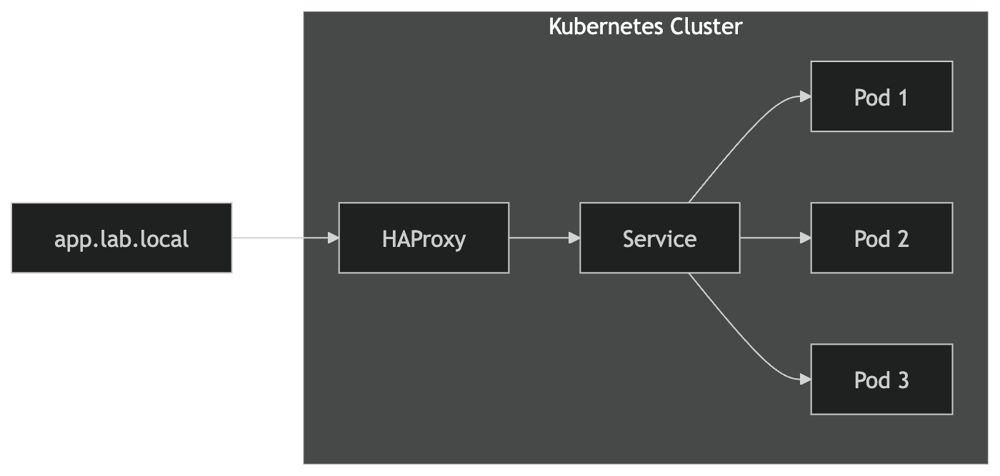
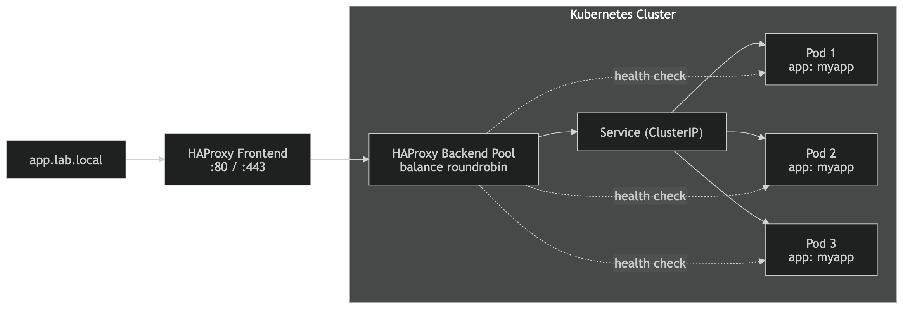

# 1- Install HAProxy Kubernetes Ingress Controller (Helm)

  

  

- First add the Helm repo:  

```bash
helm repo add haproxytech https://haproxytech.github.io/helm-charts
helm repo update
```

```bash
helm install haproxy haproxytech/kubernetes-ingress \
  --namespace ingress-controller \
  --create-namespace
```

- Verification:  
  ```
  kubectl get pods -n ingress-controller
NAME                                          READY   STATUS    RESTARTS   AGE
haproxy-kubernetes-ingress-645457494f-55kv5   1/1     Running   0          36s
haproxy-kubernetes-ingress-645457494f-nmbmx   1/1     Running   0          36s
```
  

# 2- Expose the HAProxy service
  
- Check the service:  
```
kubectl get svc -n ingress-controller
NAME                         TYPE       CLUSTER-IP      EXTERNAL-IP   PORT(S)                                                                  AGE
haproxy-kubernetes-ingress   NodePort   10.108.97.131   <none>        80:31113/TCP,443:32580/TCP,443:32580/UDP,1024:30757/TCP,6060:32408/TCP   69s
```

# 3- Example Ingress (HTTP routing). 


```bash
apiVersion: networking.k8s.io/v1
kind: Ingress
metadata:
  name: test-app
  annotations:
    kubernetes.io/ingress.class: haproxy
spec:
  rules:
  - host: app.lab.local
    http:
      paths:
      - path: /
        pathType: Prefix
        backend:
          service:
            name: my-service
            port:
              number: 80
```

kubectl apply -f ingress.yaml


### Service as ClusterIP (or NodePort/LoadBalancer)


