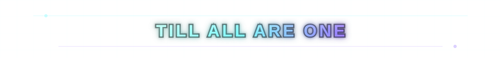
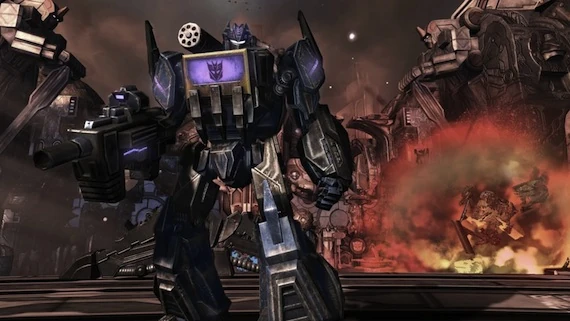
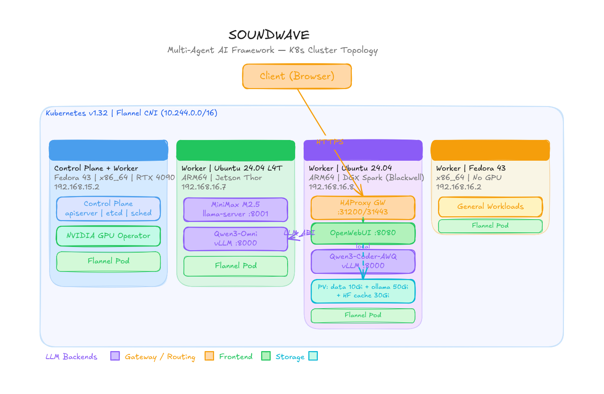
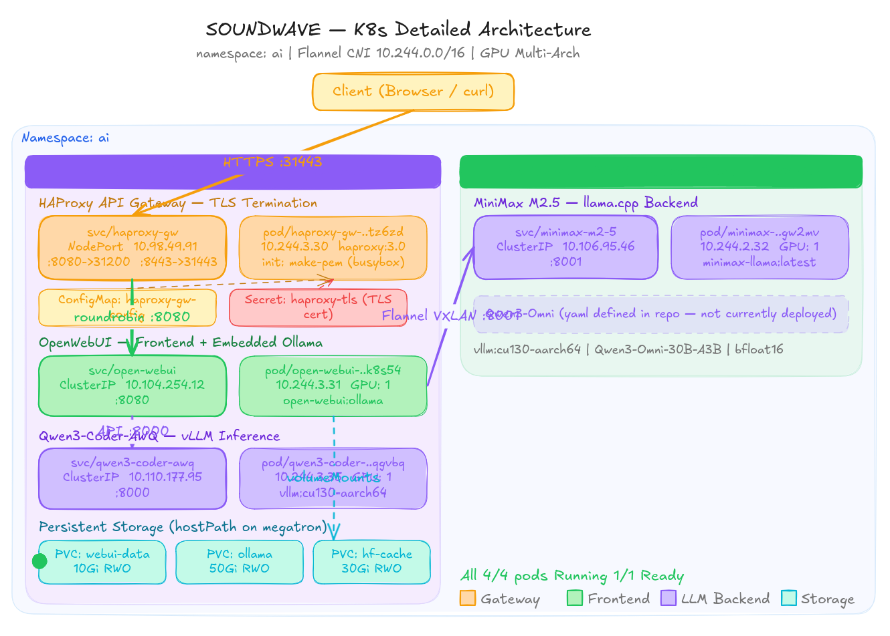
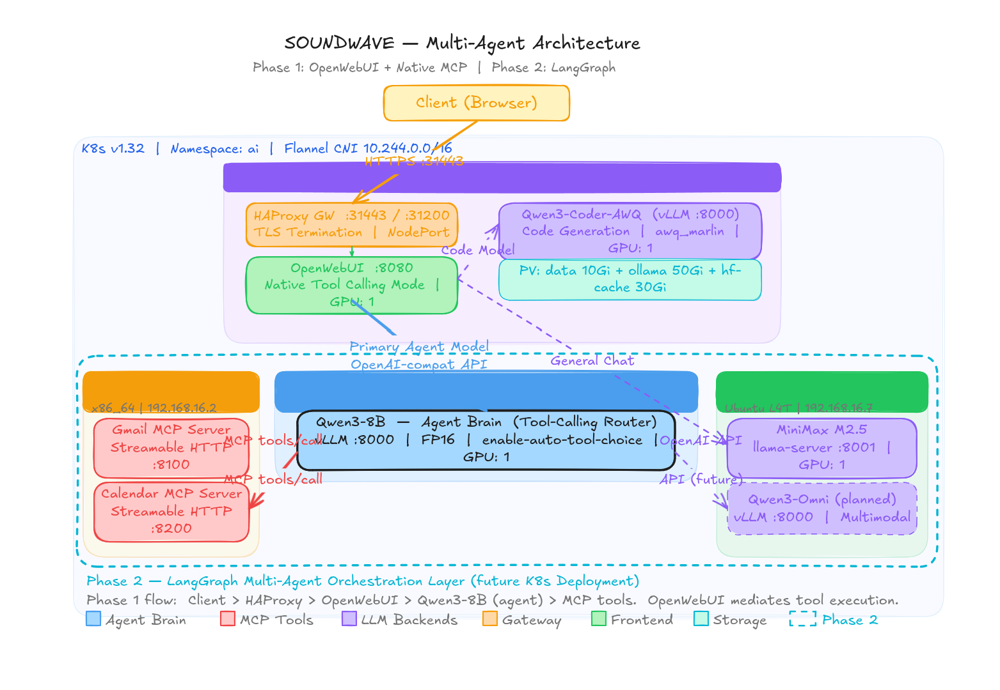

# Soundwave

<p align="center">
  <strong>Multi-agent AI framework and ecosystem</strong>
</p>

<p align="center">
  <br><br>
  
</p>

Self-hosted AI infrastructure for a heterogeneous Kubernetes lab: GPU inference, agents, speech, gateways, and MCP integrations.

**Version 2.1.0. Private publication candidate awaiting owner review.** These are reference configurations and experiments, not a turnkey installer. Hardware, container versions, storage, and endpoints must be adapted to your environment.

## Start here

- [Cluster setup](docs/setup/kubernetes-multiarch-install-guide-flannel.md)
- [Gateway setup](docs/setup/HA-Proxy.md)
- [Deployment catalog](deployments/README.md)
- [Gmail and Calendar MCP architecture](docs/architecture/phase1-multi-agent-deployment.md)
- [Hermes deployment](hermes/README.md)
- [Speech tools](ASR/README.md)
- `nanobot/`, `local-tools/`, `infra/`, `pod/` — additional experiments.
- [Hermes LLM Wiki + Obsidian](integrations/hermes-llm-wiki-obsidian/README.md) — skills, vault templates, EPUB conversion, and deployment integration.

1. Read the component guide and select only the workloads you need.
2. Adapt node selectors, model images, storage paths, network addresses, and resource requirements. Hostnames are illustrative role names.
3. Create credentials outside Git using your secret manager. See [SECURITY.md](SECURITY.md).
4. Review each manifest before applying it. Do not apply an entire directory recursively; it may include archives, debugging pods, or privileged GPU workarounds.

## Reference architecture

The original diagrams document the lab architecture and its design phases. Model placement and addresses reflect those snapshots; adapt them to your environment.



| Logical node | Reference hardware | Role |
| --- | --- | --- |
| soundwave | x86_64, RTX 4090 | Control plane and GPU/speech experiments |
| shockwave | ARM64, Jetson AGX Thor | Edge inference |
| megatron | ARM64, DGX Spark | Inference, gateway, UI, and storage experiments |
| thundercracker | x86_64, CPU | Agents, MCP adapters, and utilities |

Clients reach the gateway and UI; inference and MCP services communicate inside the cluster. Historical guides describe different model placements. Their deployment status is not inferred from the repository. LangGraph routing and additional modalities remain design proposals unless a component explicitly implements them.

### Open WebUI and model backends



### Agents and MCP

The diagram shows the Phase 1 Gmail/Calendar MCP flow and the proposed Phase 2 orchestration layer.



The [image library](assets/) also contains the HAProxy diagrams and runtime comparison.

## Releases and validation

The clean release line is `1.0.0` (legacy), `2.0.0` (rewrite plus security staging), and `2.1.0` (wiki integration). See [CHANGELOG.md](CHANGELOG.md), [release guidance](docs/releases/RELEASING.md), and the [publication checklist](docs/security/public-release-checklist.md).

```bash
python3 -m pip install -r requirements-dev.txt
python3 scripts/check-release.py
```

Validation checks source structure and security invariants without contacting a cluster. It does not establish runtime compatibility. [Contributions](CONTRIBUTING.md) should document component-specific tests.

## Licensing and attribution

The root license is pending owner selection. Review [THIRD_PARTY_NOTICES.md](THIRD_PARTY_NOTICES.md); bundled integrations preserve their license files. This is an independent personal project with no vendor affiliation.
