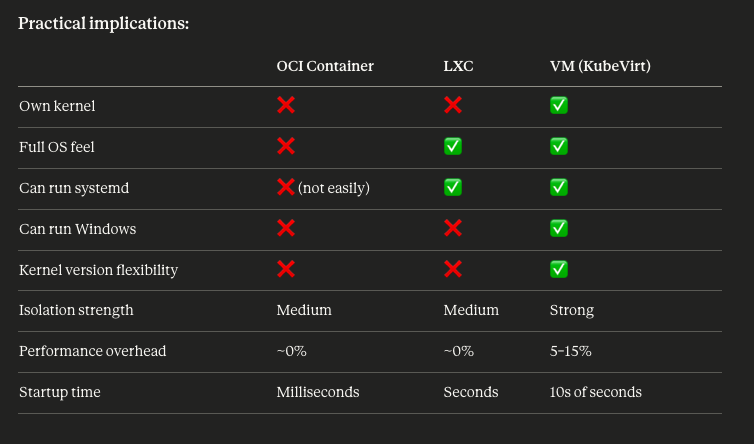

```bash
Podman:      Podman CLI  →  (no daemon)  →  runc / crun  →  kernel namespaces + cgroups
Docker:      Docker CLI  →  dockerd      →  containerd   →  runc  →  kernel namespaces + cgroups
containerd:  Kubernetes  →  containerd   →  runc / crun  →  kernel namespaces + cgroups
CRI-O:       Kubernetes  →  CRI-O        →  runc / crun  →  kernel namespaces + cgroups
LXC:         LXD/Incus   →  lxcd         →  kernel namespaces + cgroups  (no runc layer)
```

- Podman talks directly to runc or crun (the low-level OCI runtime) without any intermediate daemon. That's actually Podman's whole philosophy — it's daemonless, which is one of its main selling points over Docker.  
What they all share in common is the bottom layer:  

        - runc — the reference OCI container runtime (written by Docker, donated to CNCF)
        - crun — Red Hat's faster, lighter alternative to runc (written in C, Podman's default on Fedora)

- containerd → broadly used, great docs, what the guide already covers  
- CRI-O → more "native" to Fedora/Red Hat, lighter weight, integrates well with Podman's ecosystem  
- CRI-O is a Kubernetes CRI runtime that also uses runc/crun underneath  
- Podman is a user-facing CLI that also uses runc/crun underneath   
- They share the same low-level layer but serve completely different purposes and don't depend on each other
- LXC is the odd one out — it skips the OCI/runc layer entirely and lands directly on kernel primitives, which is why it can run a full OS userspace rather than just a single process   


```bash
VM (KubeVirt):   App  →  Guest OS (full kernel)  →  Hypervisor (KVM/QEMU)  →  Host OS  →  Hardware
LXC:             App  →  Guest userspace (no kernel)  →  Host OS kernel  →  Hardware
OCI Container:   App  →  Host OS kernel  →  Hardware
```

        - A VM runs its own completely separate kernel. The guest OS has no idea it's not on real hardware. KubeVirt/KVM emulates full virtual hardware (CPU, RAM, disk, NIC).  
        - LXC shares the host's kernel but isolates the userspace (init system, filesystem, processes). It feels like a full OS but the kernel underneath is still the host's.  
        - An OCI container also shares the host kernel but only isolates a single process/app — no init system, no full OS feel.  




Load distribuition:

- Control plane scheduling — by default kubeadm taints the control node to prevent pod scheduling, so we need to remove that taint  
- GPU support — each of your GPU nodes needs specific treatment:
  
        - RTX 4090 (control, x86_64) → standard NVIDIA discrete GPU  
        - Jetson Thor (worker-01, ARM64) → uses L4T/JetPack drivers, different from discrete GPU stack   
        - DGX Spark (worker-02, ARM64) → Grace Blackwell, needs Blackwell-compatible driver branch  

        